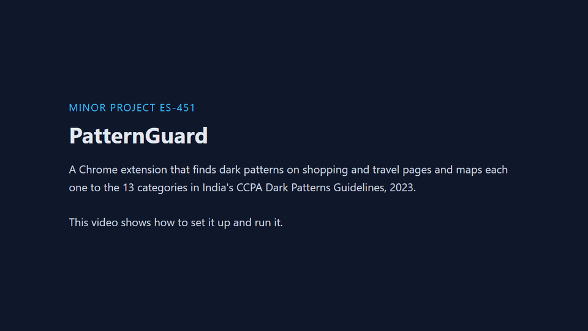

# PatternGuard setup guide

This guide takes you from a fresh computer to a running extension and a full test run. Part A is enough to use and demonstrate the extension. Part B is only needed to run the tests and the evaluation.

Demo video: [media/patternguard_demo.webm](media/patternguard_demo.webm) (about 1.5 minutes, no sound). A short preview is shown below.



## What you need

| For | Software |
|---|---|
| Part A (use the extension) | Google Chrome, Microsoft Edge, Brave or another Chromium browser; Python 3 (only to serve the demo pages); Git, or the ZIP download from GitHub |
| Part B (tests and evaluation) | Python 3.10, 3.11 or 3.12; Node.js 18 or later; about 1 GB of free disk space for Chromium and the Python packages |

## Part A: load and use the extension

### 1. Get the code

```powershell
git clone https://github.com/naman79820/patternguard
cd patternguard
```

Without Git, click **Code > Download ZIP** on the GitHub page, unzip it and open a terminal in the unzipped `patternguard` folder.

### 2. Load the extension in the browser

1. Open `chrome://extensions` (in Edge: `edge://extensions`).
2. Turn on **Developer mode** (top right in Chrome, left side in Edge).
3. Click **Load unpacked** and choose the `extension` folder inside the repository. Choose the folder itself, not a file inside it.
4. PatternGuard now appears in the list. Click the puzzle-piece icon in the toolbar and pin PatternGuard so its popup is one click away.

You can also unzip `dist/PatternGuard_extension.zip` and load that folder instead.

### 3. Serve the demo pages

The extension works on web pages, so the demo pages must be opened over `http://`, not by double-clicking the files. In the repository folder run:

```powershell
python -m http.server 8000
```

(on macOS or Linux use `python3`). Leave this terminal open.

### 4. Try it

Open these addresses in the browser where the extension is loaded:

| Page | What you should see |
|---|---|
| http://localhost:8000/demo/dark-checkout.html | 4 highlighted findings. Wait about 10 seconds, reload, and a 5th appears (the countdown timer restarted, so false urgency is reported). |
| http://localhost:8000/demo/fair-checkout.html | No findings. |
| http://localhost:8000/demo/spa-booking.html | 0 on the review step. Click **Continue to add-ons**: 3 findings. Continue to payment: 1 finding (a fee that was not shown earlier). |
| http://localhost:8000/demo/cases/ | Five reconstructed CCPA cases with made-up shop names. Some need a click on **Continue** to reach the step with the dark pattern. |

Click the PatternGuard icon in the toolbar to open the popup. It lists every finding on the current tab with its CCPA category and reason, and shows the site's Manipulation Score S.

### 5. Change thresholds (optional)

All weights and thresholds are in `extension/config.json` (for example `tau`, the reporting threshold, and the per-category `alpha` and `severity`). After editing it, click the reload icon on the PatternGuard card in `chrome://extensions` and reload the page.

## Part B: tests and evaluation (Windows, PowerShell)

### 1. Create the Python environment

```powershell
py -3.12 -m venv .venv
.venv\Scripts\python -m pip install playwright pandas scikit-learn matplotlib numpy python-docx
.venv\Scripts\python -m playwright install chromium
```

On macOS or Linux, use `python3 -m venv .venv` and replace `.venv\Scripts\python` with `.venv/bin/python` in every command.

Check that Node.js is installed:

```powershell
node --version
```

### 2. Run all tests

```powershell
powershell -ExecutionPolicy Bypass -File tests\run_all.ps1
```

This runs four groups and prints PASS or FAIL for each:

1. `tests/unit.test.js`: unit tests of the rules and the score (Node).
2. `tests/regression.py`: the demo and case pages in Chromium with the extension loaded.
3. `tests/config_test.py`: checks that changing `config.json` changes behaviour (TC-H05).
4. `tests/report_cases.py`: every test ID in report Tables 6.1 to 6.5, written to `report/test_results.json`.

The browser tests run Chromium in the background, so no window opens. One known Fail is expected in `report/test_results.json`: TC-F03, because the content script runs on all URLs.

### 3. Run the evaluation (optional)

```powershell
.venv\Scripts\python eval\datasets_summary.py
.venv\Scripts\python eval\text_eval.py
.venv\Scripts\python eval\controlled_eval.py
.venv\Scripts\python eval\make_outputs.py
```

Results are written to `eval/results.json`, `eval/results_table.md` and the figures in `eval/`.

The DistilBERT baseline is optional and needs extra packages (about 1 GB). On a CPU it took about 10 minutes:

```powershell
.venv\Scripts\python -m pip install torch --index-url https://download.pytorch.org/whl/cpu
.venv\Scripts\python -m pip install transformers datasets
.venv\Scripts\python eval\distilbert_baseline.py
```

### 4. Record the demo video again (optional)

```powershell
.venv\Scripts\python tools\demo_video.py
```

This writes `media/patternguard_demo.webm` and `media/patternguard_demo.gif`. Only local pages are opened.

## Troubleshooting

| Problem | Fix |
|---|---|
| No highlights on a demo page | Check the address starts with `http://localhost:8000`, not `file://`. Check that PatternGuard is turned on in `chrome://extensions`. |
| "Manifest file is missing or unreadable" when loading | You chose the repository folder or a file. Choose the `extension` folder. |
| The 5th finding on dark-checkout does not appear | Wait about 10 seconds after the first load before reloading. The timer must have moved by more than `timerSlackSeconds` (5) in `config.json`. |
| `python` is not found on Windows | Use `py` instead, or install Python from python.org and tick "Add python.exe to PATH". |
| Port 8000 is already in use | Run `python -m http.server 8080` and use `localhost:8080` in the addresses. |
| `run_all.ps1` cannot be run (execution policy) | Use the exact command above with `-ExecutionPolicy Bypass`. |
| Browser tests fail with "Executable doesn't exist" | Run `.venv\Scripts\python -m playwright install chromium` again. |
| Changes to `config.json` have no effect | Reload the extension in `chrome://extensions`, then reload the page. |
